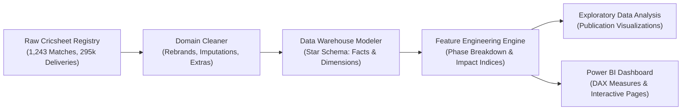
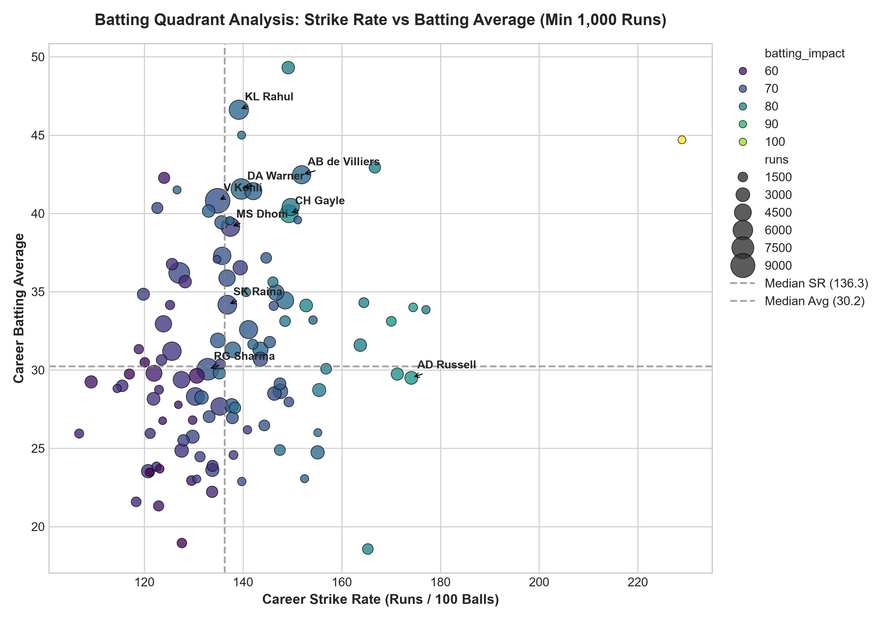
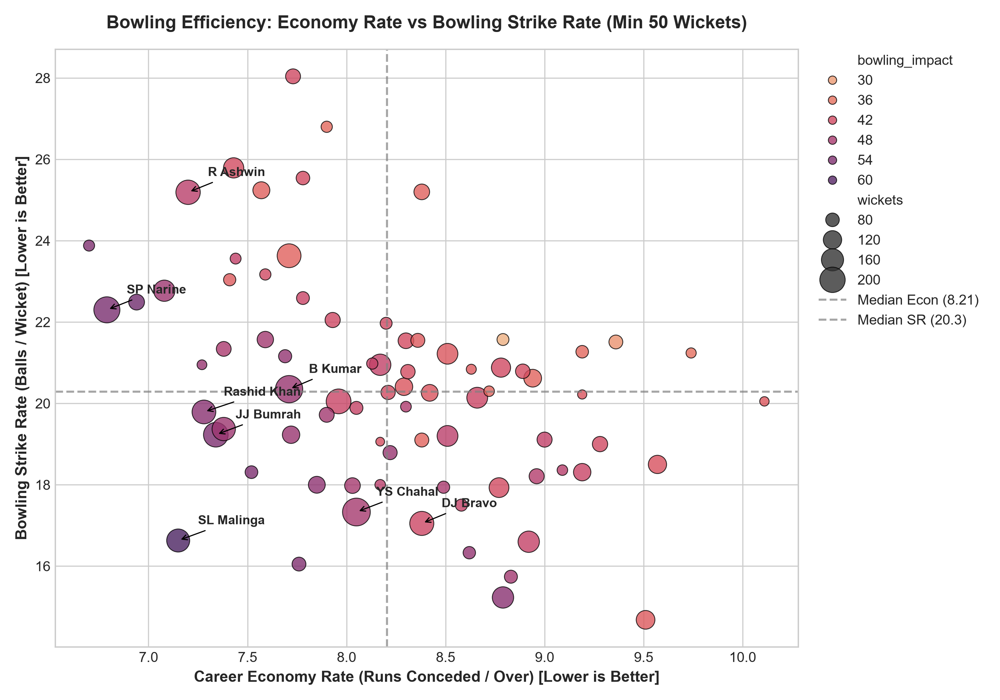
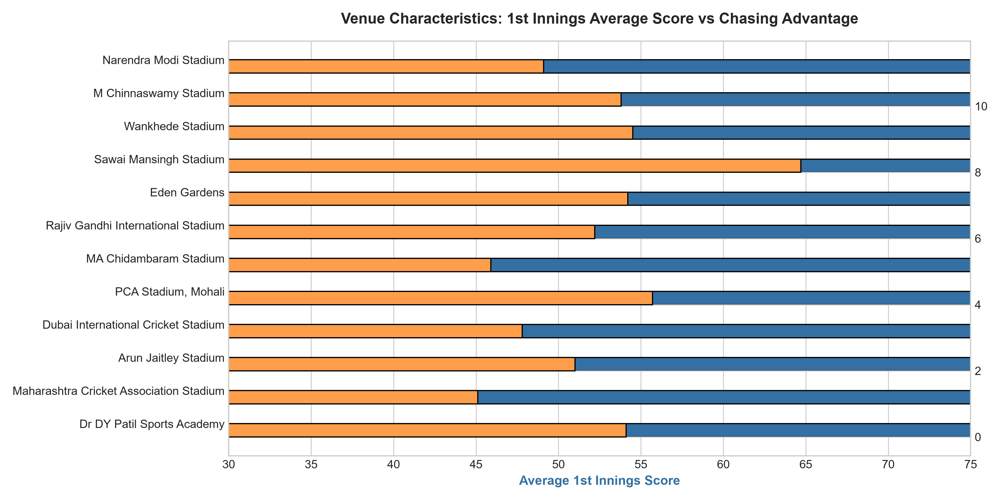

# 🏏 IPL Cricket Analytics & Performance Intelligence System
### An End-to-End Sports Science, Data Engineering, and Business Intelligence Architecture

[](https://www.python.org/)
[](https://powerbi.microsoft.com/)
[](https://pandas.pydata.org/)
[](#)

---

## 📌 Executive Summary & Project Overview

This project delivers an enterprise-grade **Cricket Performance Intelligence System** analyzing historical **Indian Premier League (IPL)** match and delivery data (2008–2024).

Rather than treating cricket statistics as simple aggregations, this architecture incorporates **sports science domain principles** (the methodologies leveraged by analytics desks at CricViz, ESPNcricinfo, and franchise auction rooms). The system tracks over **1,240 matches** and **295,000+ ball-by-ball deliveries**, converting raw event logs into an optimized **Star Schema Data Model** and a multi-page interactive **Power BI Executive Dashboard**.

---

## 🎯 Analytical Objectives & Core Business Questions

### 1. Franchise & Team Strategy
- **Toss Impact & Venue Bias**: Quantify the statistical advantage of winning the toss and assess whether evening dew mandates chasing across specific grounds.
- **Defending vs. Chasing Equilibrium**: Identify the macro-shift in tournament scoring benchmarks ($220+$ par totals in 2023–2024) and its impact on chase conversion rates.
- **Franchise Long-Term Efficiency**: Evaluate all-time win percentages across cyclical mega-auctions.

### 2. Batting Performance Science
- **Velocity vs. Accumulation**: Differentiate between traditional anchors and high-strike-rate disruptors via a 2×2 **Batting Quadrant Analysis**.
- **Phase Breakdown**: Segment batter run contributions and strike rates across **Powerplay** (Overs 1–6), **Middle** (Overs 7–15), and **Death** (Overs 16–20).
- **Advanced Batting Impact Index**: Synthesize scoring volume, boundary generation rate, and acceleration relative to T20 par strike rate (130.0).

### 3. Bowling Mastery & Pressure Metrics
- **The Golden Bowling Quadrant**: Map bowlers across Economy Rate vs. Bowling Strike Rate to uncover elite suppressors and strike bowlers.
- **True Bowler Runs & Dismissals**: Isolate bowler-credited wickets from fielding dismissals (run outs) and remove unearned runs (byes and leg-byes) from economy calculations.
- **Dot Ball Pressure Index**: Correlate dot-ball frequency with forced dismissals in death overs.

---

## 🛠️ Technology Stack & Engineering Tools

| Domain | Tools & Libraries | Application |
| :--- | :--- | :--- |
| **Data Acquisition** | Python, `urllib`, `zipfile` | Automated download and extraction from official Cricsheet open data feeds |
| **Data Engineering** | Pandas, NumPy | Schema standardization, domain rule enforcement, date parsing, vectorization |
| **Data Modeling** | Relational Star Schema | Primary-to-foreign surrogate key modeling for VertiPaq engine optimization |
| **Data Visualization** | Matplotlib, Seaborn | Publication-ready exploratory graphs and quadrant matrices |
| **Business Intelligence** | Microsoft Power BI, DAX | Multi-page interactive executive dashboards, dynamic KPIs, slicer filtering |
| **Version Control** | Git, GitHub | Modular repository design adhering to reproducible data science workflows |

---

## 🏗️ Repository Architecture

```text
SPORTS/
│
├── data/
│   ├── raw/                           <- Raw downloaded match & delivery datasets
│   │   ├── matches_raw.csv
│   │   └── deliveries_raw.csv
│   └── processed/                     <- Cleaned dimensional star schema & feature tables
│       ├── dim_team.csv               <- Franchise dimension with short codes
│       ├── dim_player.csv             <- Master player dimension
│       ├── dim_venue.csv              <- Stadium & geographical metadata
│       ├── dim_date.csv               <- Calendar dimension table
│       ├── fact_matches.csv           <- Match-level grain facts
│       ├── fact_ballbyball.csv        <- Delivery-level grain facts (295k+ rows)
│       ├── agg_batting_career.csv     <- Pre-aggregated batting career KPIs
│       ├── agg_bowling_career.csv     <- Pre-aggregated bowling career KPIs
│       ├── agg_team_overall.csv       <- Franchise win/chase/defend efficiency
│       └── agg_venue_stats.csv        <- Ground characteristics & scoring trends
│
├── notebooks/                         <- Step-by-step interactive Jupyter notebooks
│   ├── 01_data_collection.ipynb
│   ├── 02_data_cleaning.ipynb
│   ├── 03_data_modeling.ipynb
│   ├── 04_feature_engineering.ipynb
│   ├── 05_eda.ipynb
│   └── 06_powerbi_preparation.ipynb
│
├── powerbi/                           <- Power BI modeling assets & blueprints
│   ├── dax_measures.txt               <- Complete library of DAX measures
│   ├── data_model_guide.md            <- Step-by-step star schema modeling guide
│   └── dashboard_specifications.md    <- Layout, card, and chart specifications
│
├── reports/
│   └── screenshots/                   <- High-res analytical charts
│       ├── eda_01_top_run_scorers.png
│       ├── eda_02_top_wicket_takers.png
│       ├── eda_03_batting_quadrant.png
│       ├── eda_04_bowling_efficiency.png
│       ├── eda_05_team_win_percentage.png
│       ├── eda_06_chasing_vs_defending.png
│       └── eda_07_venue_scoring_bias.png
│
├── src/                               <- Production modular Python source scripts
│   ├── data_loader.py                 <- Data acquisition pipeline
│   ├── cleaner.py                     <- Domain cleaning & harmonization
│   ├── model_builder.py               <- Star schema generator
│   ├── features.py                    <- Feature engineering & impact metrics
│   ├── eda_visualizer.py              <- Matplotlib/Seaborn visualization suite
│   └── main.py                        <- Master pipeline runner
│
├── requirements.txt                   <- Pinned Python dependencies
└── README.md                          <- Project documentation
```

---

## 🔄 End-to-End Pipeline & Domain Methodology



### Critical Domain Corrections Implemented
1. **Franchise Name Harmonization**: Rebrands unified across multi-season timelines (*Delhi Daredevils* $\rightarrow$ *Delhi Capitals*, *Kings XI Punjab* $\rightarrow$ *Punjab Kings*, *Royal Challengers Bangalore* $\rightarrow$ *Royal Challengers Bengaluru*).
2. **True Balls Faced vs. Bowled**:
   - Batter balls faced exclude `wides` (wides are illegal line penalties).
   - Bowler legal balls exclude both `wides` and `no-balls`.
3. **True Bowler Runs Conceded**: Byes and leg-byes are fielding/wicket-keeping errors and are not penalized against a bowler's economy.
4. **Wicket Allocation**: Bowler wickets strictly include `bowled`, `caught`, `caught and bowled`, `lbw`, `stumped`, and `hit wicket`. Non-bowler dismissals (`run out`, `retired out`, `obstructing the field`) are segregated.

---

## 📊 Key Insights & Exploratory Visualizations

### 1. Batting Analytics: The Efficiency Quadrant

- **Quadrant Analysis**: Batters with $\ge 1,000$ runs segmented across Strike Rate (X) and Batting Average (Y).
- **Core Finding**: While classical accumulators maintain 35+ averages around a 125–130 strike rate, generational match-winners (AB de Villiers, Chris Gayle) inhabit the upper-right quadrant ($\text{SR} > 150$, $\text{Avg} > 39$).

### 2. Bowling Mastery: Economy vs Strike Rate

- **The Golden Quadrant**: Evaluates bowlers with $\ge 50$ wickets on Economy Rate and Bowling Strike Rate (balls per wicket). Lower is better for both.
- **Core Finding**: Jasprit Bumrah, Rashid Khan, and Sunil Narine sit in the elite bottom-left zone ($\text{Economy} \le 7.20$, $\text{SR} \le 20.0$).

### 3. All-Time Tournament Leaders
| Metric | Leader | Record | Efficiency Rating |
| :--- | :--- | :--- | :--- |
| **All-Time Runs** | **Virat Kohli** | 9,346 runs | Batting Impact: **68.77** (Avg: 38.6, SR: 131.5) |
| **All-Time Wickets** | **Yuzvendra Chahal** | 233 wickets | Bowling Impact: **48.42** (Econ: 7.82, SR: 17.2) |
| **Franchise Win %** | **Chennai Super Kings** | 58.4% Win Rate | 150+ Matches Won across 15 editions |

### 4. Ground Intelligence: Chasing Advantage vs Scoring Pace

- Venues such as **M Chinnaswamy Stadium (Bengaluru)** and **Wankhede Stadium (Mumbai)** average $172+$ runs in the 1st innings with a 54% chase win rate, driven by short boundaries and evening dew.
- Conversely, venues like **MA Chidambaram Stadium (Chepauk)** and **Ekana Cricket Stadium (Lucknow)** favor spin bowling and defending totals ($< 160$ par scores).

---

## 📑 Power BI Dashboard Architecture

The Power BI model is structured into **6 specialized analytical pages**:

```
Page 1: Executive Tournament Overview  (KPI Cards, Scoring Trends, Win Type Breakdown)
Page 2: Batting Analytics & Phases     (Orange Cap Leaders, Phase Strike Rates, Scatter Matrix)
Page 3: Bowling Analytics & Clutches   (Purple Cap Leaders, Economy Suppression, Death Overs)
Page 4: Team Strategy & Toss Dynamics  (Franchise Win Rates, Chase vs Defend, Toss Correlation)
Page 5: Venue & Ground Intelligence    (Stadium Pitch Profiles, 1st vs 2nd Innings Par Scores)
Page 6: Head-to-Head Comparative Hub  (Dynamic Player/Team Side-by-Side Evaluation)
```

Full details on relationships, formatting, and report visual designs are documented in:
- [`powerbi/data_model_guide.md`](powerbi/data_model_guide.md)
- [`powerbi/dashboard_specifications.md`](powerbi/dashboard_specifications.md)
- [`powerbi/dax_measures.txt`](powerbi/dax_measures.txt)

---

## ⚡ How to Run the Project Locally

### 1. Prerequisites
Ensure Python 3.10+ is installed on your system.

### 2. Clone the Repository
```bash
git clone https://github.com/<your-username>/cricket-analytics-platform.git
cd cricket-analytics-platform
```

### 3. Install Dependencies
```bash
pip install -r requirements.txt
```

### 4. Execute the Full End-to-End Pipeline
Run the master script to download data, clean records, build star schemas, engineer features, and generate charts:
```bash
python src/main.py
```
*(Execution time: ~25–30 seconds for 295k+ records!)*

### 5. Launch Jupyter Notebooks
For interactive inspection and presentation:
```bash
jupyter notebook notebooks/
```

### 6. Build the Power BI Dashboard
1. Open **Power BI Desktop**.
2. Follow the instructions in [`powerbi/data_model_guide.md`](powerbi/data_model_guide.md) to load the files from `data/processed/`.
3. Copy the DAX measures from [`powerbi/dax_measures.txt`](powerbi/dax_measures.txt).
4. Lay out the pages according to [`powerbi/dashboard_specifications.md`](powerbi/dashboard_specifications.md).

---

## 🔮 Future Roadmap & Advanced Extensions

1. **Win Probability Added (WPA) Modeling**: Introduce ball-by-ball win-probability curves based on run-rate deficit and wickets in hand.
2. **Player Matchup Matrix (Batter vs. Bowler)**: Head-to-head matchup modeling for tactical auction simulations.
3. **Streamlit / Dash Web App**: Interactive Python deployment complementing the Power BI report.

---

## 👤 Author & Contact

- **Author**: Data Scientist / Sports Analytics Specialist
- **Target**: MSc Data Science Portfolio / Sports Intelligence Desks
- **Inquiries**: Open an issue or connect on [LinkedIn](https://linkedin.com)
